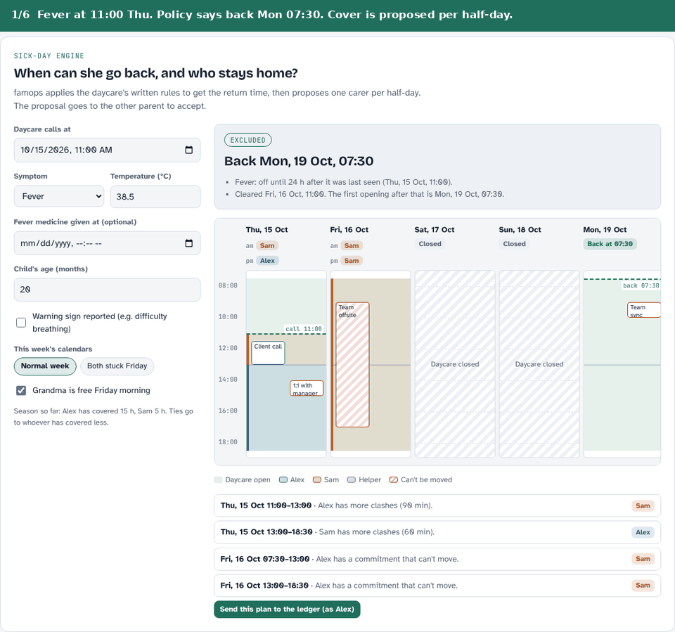

# famops

[](https://github.com/dk-lee-sk/famops/actions/workflows/ci.yml)


**A shared operations layer for two-parent households.** famops keeps track of who owns each family task, works out sick-day exclusions and proposes cover, and flags age-based deadlines before they become urgent. It plugs into any AI assistant that supports MCP (Model Context Protocol), Claude included.

> Parental mental load is an **ownership** problem, not an information problem. In famops every task has exactly one owner, and nothing lands on the other parent until they say yes.



*The rules in action (interactive demo running the same logic as the code): a Thursday fever call becomes a return date and a half-day cover plan; when both parents are stuck, a helper is proposed before "backup needed"; the other parent's blocks arrive as offers they accept.*

## What it does

| Job | How famops handles it |
|---|---|
| **Daycare sick call** | Applies the daycare's written policy to work out the earliest return. It asks for the child's age and the red-flag check first, and it accounts for fever medicine hiding a fever. |
| **Who stays home** | Proposes one carer per **half-day**, using both calendars, meetings that can't move, and who has covered more this season. If both parents are stuck, it offers a helper (a grandparent or nanny) before flagging "backup needed". |
| **Who owns what** | Every task has one owner. Handing a task over is a proposal the other parent accepts or declines. Unanswered handoffs return to the sender after 24 hours. Balance is shown in minutes of effort, not just task counts. |
| **What's coming** | Turns a birth date into tasks, from waitlists in pregnancy to the first day of school. It uses corrected age for premature babies and doesn't duplicate tasks already in the ledger. |

**Safety boundary.** famops never assesses symptoms. A reported red flag, or a fever in a baby under 3 months, returns "contact a doctor" and no date. The bundled daycare policy is **synthetic**: replace it with your own daycare's.

## Try it in 2 minutes

```bash
git clone https://github.com/dk-lee-sk/famops && cd famops
python3 -m venv .venv && source .venv/bin/activate
pip install -e ".[dev]"
famops demo            # Thursday sick call: return date, half-day cover, Grandma steps in Friday morning
pytest                 # 42 checks
```

## Connect it to Claude

Each parent sets up their **own** connection, with their own name. famops only ever acts as that person.

```json
{
  "mcpServers": {
    "famops": {
      "command": "famops-mcp",
      "env": {
        "FAMOPS_USER": "Alex",
        "FAMOPS_DB": "~/.famops/famops.db",
        "FAMOPS_POLICY": "/path/to/your_daycare_policy.yaml"
      }
    }
  }
}
```

Start with "Set up our household: Alex and Sam." Then, for example: *"Daycare called, fever 38.5 at 11. When can she go back, and who covers?"*

**Sharing between two parents (current limit).** Both connections must use the same database file, so for now both parents use famops from one computer. A hosted shared ledger with a login for each parent is the next step on the roadmap.

## Tools

| Tool | Purpose |
|---|---|
| `set_household(members)` / `whoami()` | Register the adults; check who this connection acts for |
| `create_task(title, owner?, due?, effort_min?)` | Create a task for yourself, or propose one to your partner |
| `handoff_task(id, to_owner)` / `respond_to_handoff(id, accept)` | Offer a task to your partner; accept or decline one offered to you |
| `complete_task(id)` / `list_tasks()` / `load_balance()` | Mark a task done, list tasks, see who carries what |
| `report_illness(symptoms, child_age_months, red_flags)` | Earliest return date, or `escalate` / `needs_info` |
| `plan_sick_cover(now, return_at, parents, helpers?, propose_tasks?)` | Half-day cover plan; with `propose_tasks`, each block is sent to its parent to accept |
| `upcoming_for_child(dob, weeks_premature?)` / `add_upcoming_to_ledger(dob)` | What's due, and turn it into owned tasks |

## Your daycare's policy

Copy `src/famops/data/policy_example.yaml` and set:

- opening hours and closure dates
- the half-day handover time
- one exclusion rule per symptom
- how long a dose of fever medicine counts as hiding a fever
- the red flags

## Roadmap

| Next | Why |
|---|---|
| Hosted shared ledger with a login for each parent | So two parents on two phones share one ledger |
| Google Calendar and ICS "busy/free" sync | Removes typing calendars into the chat |
| Daycare email to owned tasks | Covers the largest category of everyday admin |
| Country versions (Switzerland, Singapore, Thailand) | School entry and paperwork rules differ by country; the current set is US-centred |
| Several children, recurring tasks | Siblings and weekly chores |

See [CHANGELOG.md](CHANGELOG.md) for what changed in each version and [docs/PRODUCT.md](docs/PRODUCT.md) for strategy.

## Caveats

- This is a prototype and is not medical software.
- Evidence behind the taxonomy is mostly from the US.
- Taxonomy rows marked `U` are unsourced.

MIT licence.
